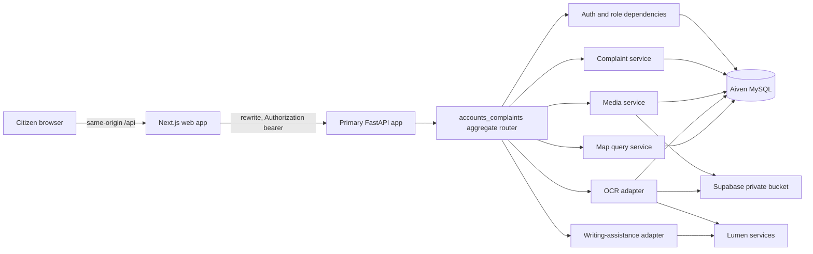

# Design Document: Complete Citizen Complaint Integrations

## Overview

This design completes photo evidence, Lumen writing assistance, OCR, and the community map in the canonical citizen application under `lumen/apps/web/src/app/app`. It consolidates the useful behavior currently isolated in `media_backend`, `chatbot_backend`, and `map_backend` into the primary FastAPI application and the shared `accounts_complaints` package.

The existing `lumen/modules/accounts_complaints/schema.sql` remains the operational database baseline. A new ordered migration adds an object-key-backed `complaint_media` table. This design does not adopt or migrate the application to `db/schema.sql`, and it does not persist new image binaries in MySQL.

The design preserves these boundaries:

- The browser calls only same-origin `/api/*` routes.
- `lumen/apps/api/app/main.py` is the only deployed FastAPI composition root.
- `accounts_complaints` owns authentication, authorization, database access, complaint behavior, integration routers, and external-service adapters.
- Supabase and Lumen credentials exist only in server configuration.
- Supabase uses a private bucket. Clients receive authorized application URLs or short-lived signed URLs, never service credentials.
- The citizen remains responsible for the final complaint description. AI and OCR output are suggestions.
- `NEXT_PUBLIC_USE_MOCKS=true` continues to select a contract-compatible in-browser implementation.

## Goals and Non-Goals

### Goals

1. Mount all accounts, complaint, media, assistant, OCR, and map routes in the primary FastAPI app.
2. Provide an all-or-nothing complaint-with-photos submission path with best-effort external compensation.
3. Store image objects in a private Supabase bucket and metadata in Aiven MySQL.
4. Enforce active-user, role, complaint ownership, and media ownership checks before private-object or Lumen access.
5. Normalize Lumen responses into small, stable browser contracts.
6. Replace the `/app/report` and `/app/map` placeholders and complete the existing citizen reports path needed by those flows.
7. Preserve current complaint validation, duplicate handling, support rules, staff behavior, privacy, and mock mode.
8. Add host-level, package-level, adapter, component, and contract tests.

### Non-Goals

- Migrating to `db/schema.sql` or reconciling unrelated database schemas.
- Making the Supabase bucket public.
- Uploading directly from the browser with the Supabase service role.
- Persisting Lumen chat histories or treating generated text as authoritative.
- Automatic severity classification, dispatch, or complaint submission.
- Replacing the existing bearer-token/session-storage authentication model.
- Adding background-job infrastructure. Failed object deletions are handled by bounded retries and an operational reconciliation command.
- Keeping the three standalone services as separately deployed production applications.

## Current Constraints and Decisions

| Concern | Existing state | Design decision |
|---|---|---|
| Primary API | `lumen/apps/api/app/main.py` exposes only `/health` | Install/import `accounts_complaints` and include its aggregate router once. |
| API prefix | Next.js rewrites browser `/api/*` to an unprefixed FastAPI route | Keep FastAPI routes unprefixed and use one `/api` rewrite. |
| Database | `accounts_complaints/schema.sql` is the package source of truth | Keep it as the baseline; add one ordered media migration under the package. |
| Media | Standalone service stores `MEDIUMBLOB image_data` in MySQL | Replace active behavior with Supabase object storage and metadata-only MySQL rows. |
| Registration | Mock expects a token; real `/auth/register` returns `UserOut` | Make registration return `TokenResponse`, matching `AuthProvider` and mock mode. |
| Citizen list | Real `GET /complaints` is staff-only | Permit citizens only when `mine=true`; staff behavior remains unchanged. |
| Response privacy | `_out` currently treats any authenticated user as staff | Select `ComplaintStaffOut` only for `official` and `pasig_admin`. Citizens receive `ComplaintOut`. |
| Writing | Standalone service returns raw session/send/history shapes | Return only normalized suggestion and `review_required`. |
| OCR | Standalone service reads MySQL image bytes and is staff-only | Authorize owner/staff, fetch the private object server-side, normalize and save text. |
| Map | Standalone marker route is staff-only | Add an authenticated, citizen-safe marker projection with category/status/bounds filters. |
| Frontend media proxy | HTTP client uses `/media` and a second target | Move media calls to the standard `/api` client and remove the separate production proxy. |
| Leaflet | Dependencies already exist | Use a client-only Leaflet component dynamically imported by the canonical route. |

## Architecture



### Backend module layout

The primary host imports the package router. It does not import any standalone FastAPI `app` object.

```text
lumen/apps/api/app/main.py
  -> accounts_complaints.router
       -> routers/auth.py
       -> routers/categories.py
       -> routers/complaints.py
       -> routers/users.py
       -> routers/logs.py
       -> routers/media.py              (new)
       -> routers/assistant.py          (new)
       -> routers/map.py                (new)

accounts_complaints/services/
  complaints.py                         (transaction-aware creation helpers)
  media.py                              (validation, ownership, orchestration)
  object_storage.py                     (Supabase adapter/protocol)
  lumen_writing.py                      (normalized writing adapter)
  lumen_ocr.py                          (normalized OCR adapter)
  map.py                                (safe marker query)
```

The standalone directories remain only as migration references during the change. Their production launch instructions are retired after equivalent shared-package routes and tests exist. Shared code must not import their engines, settings, JWT helpers, or app instances.

## Components and Interfaces

External systems are hidden behind injectable protocols:

```python
class ObjectStorage(Protocol):
    async def upload(self, *, object_key: str, content: bytes, content_type: str) -> None: ...
    async def download(self, *, object_key: str) -> bytes: ...
    async def delete(self, *, object_key: str) -> None: ...
    async def create_signed_url(self, *, object_key: str, expires_in: int) -> str: ...

class ComplaintWritingAssistant(Protocol):
    async def suggest(self, *, notes: str) -> str: ...

class OcrProvider(Protocol):
    async def extract(self, *, content: bytes, content_type: str, filename: str) -> str: ...
```

Routers depend on service functions, and service functions accept these interfaces through FastAPI dependencies. Tests replace them with deterministic fakes. The Supabase and Lumen implementations use one configured `httpx.AsyncClient` lifecycle per API process rather than creating unbounded clients per call.

## Primary API Composition

`lumen/apps/api/app/main.py` creates the application, registers lifespan-managed HTTP clients, includes `accounts_complaints.router`, and keeps `/health`. An optional `/health/db` may check database reachability without returning connection details. Optional external integrations are not contacted by health checks; missing optional integration configuration produces a scoped `503` only when that capability is requested.

The local `accounts_complaints` package becomes an explicit API environment dependency through its `pyproject.toml`/editable install or deployment build configuration. Runtime `sys.path` mutation is not used.

Next.js has one rewrite:

```text
browser /api/:path* -> API_PROXY_TARGET/:path*
```

`MEDIA_PROXY_TARGET` and the separate `/media` Axios client are removed after all callers use `/api`. No browser-visible Supabase or Lumen environment variable is introduced.

## Data Models

### Operational baseline

`lumen/modules/accounts_complaints/schema.sql` continues to define users, logs, categories, complaints, and supports. Existing complaint coordinates, reference numbers, statuses, duplicate rules, and reporter fields remain unchanged. The `complaints.photo_url` compatibility column is not used for new multi-photo writes; read code may continue to tolerate old values.

### Additive migration

Add `lumen/modules/accounts_complaints/migrations/20261114_create_object_backed_complaint_media.sql`, ordered after `20261113_add_citizen_role.sql`.

The migration creates `complaint_media` against the accounts/complaints baseline:

| Column | Type | Rules and purpose |
|---|---|---|
| `id` | `BIGINT UNSIGNED` | Primary key, auto increment. |
| `complaint_id` | `BIGINT UNSIGNED` | Required FK to `complaints(id)`, cascade delete. |
| `uploaded_by` | `BIGINT UNSIGNED` | Required FK to `users(id)`. |
| `media_type` | `ENUM('initial','progress','other')` | Citizen evidence or staff progress/other media. |
| `storage_bucket` | `VARCHAR(100)` | Configured private bucket name at write time. |
| `object_key` | `VARCHAR(500)` | Unique opaque key; never a service credential or expiring signed URL. |
| `mime_type` | `VARCHAR(100)` | MIME derived from decoded image content. |
| `file_size_bytes` | `BIGINT UNSIGNED` | Required verified payload size. |
| `original_filename` | `VARCHAR(255)` | Sanitized basename for display only. |
| `image_analysis` | `JSON NULL` | Reserved structured analysis result; never image bytes. |
| `ocr_text` | `MEDIUMTEXT NULL` | Normalized extracted text. |
| `uploaded_at` | `DATETIME` | Creation timestamp. |
| `updated_at` | `DATETIME` | Updated when OCR/analysis changes. |

Indexes cover `(complaint_id, uploaded_at)`, `(uploaded_by, uploaded_at)`, and a unique `object_key`. The table contains no `BLOB`, `MEDIUMBLOB`, or `image_data` column.

This migration is written for the declared accounts/complaints baseline, where `complaint_media` does not exist. Deployment preflight must fail clearly if the disconnected legacy `media_backend/schema.sql` table already exists with `image_data`; it must not silently treat that incompatible table as migrated. Such an environment requires a separately reviewed one-time export-to-Supabase/backfill/drop procedure. New application writes never target the legacy binary shape.

### ORM and response models

Add `ComplaintMedia` to `models.py`. Add strict schemas for media metadata, composite submission, draft suggestion, OCR result, and map markers to `schemas.py`.

`MediaOut.access_url` is an application URL such as `/api/media/{id}/content`, not a stored public URL. The content endpoint verifies authorization and then either streams the server-fetched object or redirects to a very short-lived signed URL. Redirect is preferred for scale; its TTL is configurable and the private bucket remains authoritative.

## API Contracts

All field names remain snake_case in JSON except no legacy camelCase response is preserved solely for the disconnected service. Frontend types mirror these contracts.

### Authentication adjustment

`POST /auth/register`

- Request: existing `CitizenRegistration` fields.
- Response: `201 TokenResponse`.
- Behavior: create the active citizen, record `account_created`, issue a citizen token, and allow `AuthProvider` to fetch `/auth/me`.
- Frontend registration fields that have no database representation, especially `contact_number`, are removed from the real/shared contract. `barangay` is either added consistently to `CitizenRegistration` and persisted to `users.barangay`, or omitted from the form; this design chooses to add optional `barangay` because the column already exists. No new contact-number column is introduced.

### Complaints

Existing JSON route:

```http
POST /complaints
Content-Type: application/json
Authorization: Bearer <citizen token>
```

This remains the no-photo/manual path and returns `ComplaintOut`. Existing coordinate, category, text, duplicate, and rate-limit behavior remains.

Composite photo route:

```http
POST /complaints/with-media
Content-Type: multipart/form-data
Authorization: Bearer <citizen token>

complaint: <JSON matching ComplaintCreate without photo_url>
files: <repeated image parts>
```

Success response:

```json
{
  "complaint": { "id": 123, "reference_no": "PSG-2026-000123" },
  "media": [
    {
      "id": 45,
      "complaint_id": 123,
      "media_type": "initial",
      "access_url": "/api/media/45/content",
      "mime_type": "image/jpeg",
      "file_size_bytes": 204800,
      "original_filename": "pothole.jpg",
      "ocr_text": null,
      "uploaded_at": "2026-11-14T10:00:00"
    }
  ]
}
```

The route requires at least one file and enforces `MEDIA_MAX_FILES_PER_COMPLAINT`. It rejects the entire request before writes if any file fails validation. It returns `201` only after the complaint and every media row commit successfully.

Existing list route authorization becomes role-aware:

- Staff may use all current list/filter options and receive `Page[ComplaintStaffOut]`.
- Citizens may call only `GET /complaints?mine=true`; the service forces `created_by_user_id=current_user.id` and returns `Page[ComplaintOut]`.
- Citizens cannot remove `mine`, substitute a creator ID, or receive staff fields.
- Anonymous callers remain unable to list collections.

`GET /complaints/{id}` continues to expose only the existing public-safe complaint projection to anonymous users and citizens. Only staff receive `ComplaintStaffOut`.

### Media

```http
POST /complaints/{complaint_id}/media
GET  /complaints/{complaint_id}/media
GET  /media/{media_id}/content
POST /media/{media_id}/ocr
```

Rules:

- A citizen may add only `initial` media to a complaint whose `created_by_user_id` equals their user ID.
- Staff may add only `progress` or `other` media to any complaint, preserving current staff intent.
- Listing and content access require either complaint ownership or a staff role.
- OCR requires either complaint ownership or a staff role.
- Every authorization check completes before object-store access or a Lumen call.
- Content responses use `Content-Type` from verified stored metadata and safe `Content-Disposition`; user filenames never become object paths or response headers without escaping.

`POST /media/{id}/ocr` returns:

```json
{
  "media_id": 45,
  "status": "completed",
  "extracted_text": "normalized text",
  "review_required": true
}
```

It never changes `complaints.description`.

### Writing assistance

```http
POST /assistant/complaint-draft
Authorization: Bearer <citizen token>
Content-Type: application/json

{ "notes": "Citizen-entered facts, 5 to 5000 characters" }
```

Success:

```json
{
  "suggestion": "A concise factual draft.",
  "review_required": true
}
```

The adapter creates/sends through the configured Lumen chat instance but does not return session IDs, histories, raw upstream bodies, model metadata, or headers. It selects the latest non-empty assistant text from explicitly supported response shapes. Empty, non-text, or over-limit results are unusable upstream responses and map to a safe `502`.

The system prompt instructs Lumen to preserve only supplied facts, avoid severity, avoid adding responsible parties or claims, and return only a concise draft. The adapter does not expose an automated severity field. Semantic factuality is reinforced through prompt examples and review requirements; the citizen's edited description remains authoritative.

The standalone public `/instances` diagnostic route is not exposed by the primary application.

### Citizen-safe map

```http
GET /map/complaints
Authorization: Bearer <active user token>
```

Supported query parameters:

- repeated `category_id`
- repeated `status`
- all-or-none `min_lat`, `min_lng`, `max_lat`, `max_lng`
- `page` and `page_size` with a maximum of 500 per page

Default status is the active set `open,in_progress`; the UI can explicitly request resolved or rejected records through the advertised status filter. Bounds must be finite, in geographic range, and ordered (`min < max`). Unknown/inactive category filters and malformed statuses fail validation rather than being ignored.

Response:

```json
{
  "items": [
    {
      "id": 123,
      "reference_no": "PSG-2026-000123",
      "title": "Pothole on Example Street",
      "category_id": 1,
      "status": "open",
      "latitude": 14.58,
      "longitude": 121.08,
      "barangay": "Example",
      "report_count": 3,
      "created_at": "2026-11-14T10:00:00"
    }
  ],
  "total": 1,
  "page": 1,
  "page_size": 500
}
```

This is a dedicated allowlisted projection. It cannot serialize reporter name/contact, creator ID, complaint description, private notes, media keys, OCR text, credentials, or staff-only fields. The query is read-only. The UI loads all pages for the current filter/bounds and renders one marker per returned item.

## Detailed Data Flows

### Complaint submission without photos

1. The report form validates category, title, description, and pin locally for immediate feedback.
2. The client optionally calls duplicate preview.
3. It submits the existing JSON `POST /complaints` contract.
4. FastAPI authenticates an active citizen and applies existing server validation and duplicate locking.
5. MySQL commits the complaint and audit record.
6. The client invalidates complaint queries and routes to the saved complaint/confirmation view.
7. No Supabase or Lumen call occurs.

### Complaint submission with photos

```mermaid
sequenceDiagram
    participant UI as Report form
    participant API as FastAPI
    participant DB as Aiven MySQL
    participant Store as Supabase private bucket

    UI->>API: POST /complaints/with-media (data + files)
    API->>DB: Authenticate active citizen
    API->>API: Validate complaint and every image
    API->>DB: Begin transaction, check duplicate, insert complaint (flush ID)
    loop each validated image
        API->>Store: Upload opaque object key
        Store-->>API: Accepted
        API->>DB: Insert media metadata
    end
    API->>DB: Insert audit and commit
    API-->>UI: 201 complaint + media metadata

    alt upload, metadata, or commit failure
        API->>DB: Roll back transaction
        loop uploaded objects
            API->>Store: Delete object with bounded retry
        end
        API-->>UI: Safe retryable error; no attachment claimed saved
    end
```

The complaint service gains a transaction-aware creation primitive that flushes but does not commit. The existing no-photo service wraps that primitive and retains its current commit behavior. This avoids nested commits and keeps duplicate locking and audit behavior consistent.

Images are read only up to `MEDIA_MAX_SIZE_BYTES + 1`. Pillow decodes/verifies actual JPEG, PNG, or WebP content independently of extension and client MIME. Validation records decoded format, dimensions, and verified MIME. Decompression-bomb protections and configurable pixel limits apply. Filenames are reduced to a sanitized basename, control characters are removed, and length is capped.

Object keys are generated server-side, for example `complaints/{complaint_id}/{uuid}.{verified_extension}`. Original filenames never determine a storage path.

If compensation deletion fails after bounded retries, the API still returns failure, logs only request ID and object key, and never creates a media access path. A maintenance command lists old objects under the controlled prefix and deletes objects with no matching `complaint_media.object_key`. The private bucket and absence of metadata prevent browser disclosure while reconciliation is pending.

### Writing assistance

1. The form keeps raw notes in local React state.
2. The citizen explicitly selects “Improve writing.”
3. The API authenticates an active citizen before creating a Lumen request.
4. The server sends the minimum required notes plus the constrained instruction.
5. The adapter normalizes supported Lumen response shapes into one suggestion.
6. The UI displays the suggestion in a separate review panel with “Use suggestion,” copy, edit, and dismiss actions.
7. Only “Use suggestion” copies text into the description field. Editing that field changes only local form state.
8. A failed request leaves notes and description untouched and keeps manual submission enabled.

### OCR

1. The citizen opens saved media attached to their own complaint and explicitly selects “Extract text.”
2. The API authenticates the active user, loads the media/complaint relation, and authorizes owner or staff.
3. Only after authorization, the server downloads the object from the configured private bucket.
4. The server sends the verified MIME, sanitized filename, and bytes to Lumen OCR with server-only credentials and timeout.
5. The adapter normalizes a supported text field and rejects empty/unusable output.
6. MySQL updates `complaint_media.ocr_text` and `updated_at`; it does not write image bytes.
7. The UI shows extracted text separately with copy, use, edit, and ignore actions. “Use” copies it to the complaint description editor but does not submit.

### Community map

1. `/app/map/page.tsx` renders a client feature component through a no-SSR Leaflet boundary.
2. The component loads active categories and map markers through `PKonekApi` and React Query.
3. Viewport/category/status changes update the validated query; requests are debounced and previous requests are canceled or superseded.
4. The client follows pagination until all marker pages for the current query are loaded.
5. Each marker popup shows only reference number, title, category, status, report count, and a link to `/app/reports/{id}`.
6. The map never writes complaint/media state. Support remains an explicit action on complaint detail and uses the existing proximity rules.

## Frontend Design

### Canonical routes

Thin route files remain canonical:

- `src/app/app/report/page.tsx` renders `CitizenReportForm` instead of `ComingSoon`.
- `src/app/app/map/page.tsx` renders `CitizenCommunityMap` instead of `ComingSoon`.
- `src/app/app/reports/page.tsx` renders the authenticated citizen-owned list required by the existing dashboard.
- `src/app/app/reports/[id]/page.tsx` is added for marker/dashboard navigation and owner media/OCR actions.

All routes remain protected by `src/app/app/layout.tsx` and server-side API authorization.

### Report form state

The report form has explicit state for:

- category, title, manual notes, authoritative description, address/barangay, and pin;
- selected files and local preview URLs;
- duplicate preview/candidates;
- writing-assistance request and separate suggestion;
- submission/upload progress and retryable error;
- saved complaint/media result;
- OCR request and separate extracted-text suggestion after save.

Object preview URLs are revoked when a file is removed or the component unmounts. Buttons prevent duplicate submits while a request is in flight. Client validation mirrors server limits for usability but never replaces server validation.

On a duplicate preview or submission `409`, the form displays candidate reference, title, distance, status, and report count, and offers the existing support action. It does not hide the server's duplicate decision.

### Map rendering

Leaflet and `react-leaflet` are dynamically imported in a client component to avoid server-side `window` access. Leaflet CSS and marker assets are loaded through the established Next.js asset strategy. Initial bounds use configured Pasig bounds already mirrored in `types.ts`; server data remains authoritative.

The filter controls use active categories and typed complaint statuses. Loading, empty, partial-page, 401, invalid-filter, and dependency-error states are visible and actionable. No placeholder success toast remains.

### API and types

Extend `PKonekApi` with:

```typescript
complaints.createWithMedia(input: ComplaintCreate, files: File[]): Promise<ComplaintSubmission>
complaints.listMine(filters?: CitizenComplaintFilters): Promise<Page<Complaint>>
media.list(complaintId: number): Promise<ComplaintMedia[]>
media.upload(complaintId: number, file: File, mediaType?: MediaType): Promise<ComplaintMedia>
media.runOcr(mediaId: number): Promise<OcrResult>
assistant.suggestComplaint(notes: string): Promise<ComplaintDraftSuggestion>
map.listComplaints(filters?: MapFilters): Promise<Page<MapMarker>>
```

The HTTP implementation uses the existing `/api` Axios instance for every method. Multipart requests do not set a manual `Content-Type` boundary. Existing interceptors continue to attach tokens, normalize API errors, and signal authenticated `401` responses.

`types.ts` adds the corresponding strict types and aligns `MediaType` to `initial | progress | other`. It removes stale comments about absent citizen accounts and staff-only media. `queries.ts` adds stable keys for citizen complaints, complaint media, and map filters. Mutations invalidate the relevant list, detail, media, and map keys after success.

### Mock mode

`createMockApi` implements every new contract method without network access:

- composite creation validates all files before mutating mock state;
- media rows contain mock access URLs/data URLs but expose the same metadata shape;
- ownership and media-type rules match real mode;
- writing assistance returns a deterministic review-required suggestion and supports injected failures in tests;
- OCR returns deterministic review-required text and never edits the complaint;
- map returns the same allowlisted marker projection and filtering/pagination behavior;
- citizen registration, `mine` listing, and privacy match the real API.

Mock persistence schema is versioned or reset safely when the new media collection is introduced. Existing demo accounts and the `NEXT_PUBLIC_USE_MOCKS` switch continue to work.

## Error Handling

### Stable error policy

The backend uses the existing FastAPI `detail` envelope and the frontend's `ApiError` normalization. User-facing responses never include upstream response bodies, stack traces, SQL, object-store headers, configured URLs containing credentials, or secret values.

| Condition | Status | Safe behavior |
|---|---:|---|
| Missing/invalid/expired token | 401 | Reject before storage or Lumen access; client clears an invalid authenticated session. |
| Wrong role or complaint/media owner | 403 | Reject without confirming private-object contents. |
| Missing complaint/media | 404 | Generic resource-not-found response. |
| Duplicate complaint | 409 | Preserve current safe candidate details and support direction. |
| Empty image | 400 | No DB or object write. |
| Invalid fields, bounds, category, media type | 422 | Actionable field-safe validation; no external write. |
| Oversized image | 413 | Stop after configured byte limit plus one; no external write. |
| Unsupported/corrupt/mislabeled image | 415 | Explain accepted formats; no external write. |
| Supabase unavailable/rejects upload | 502 | Roll back, compensate uploaded objects, return retry guidance. |
| Storage/Lumen not configured | 503 | Scope failure to requested optional capability; manual complaint path stays available. |
| Lumen rejects or returns unusable content | 502 | Keep citizen input; return generic assistance/OCR failure. |
| Lumen or storage timeout | 504 | Keep citizen input; return retry guidance. |
| Unexpected database failure | 500 | Roll back and compensate; log correlation ID, not payload/secrets. |
| Compensation incomplete | 502 | Never claim success; record safe reconciliation data and retain private isolation. |

External adapters translate provider-specific failures into internal typed exceptions. Routers perform the final status mapping. Logs contain operation, actor ID where appropriate, complaint/media ID, object key or hashed key, provider name, status class, elapsed time, and correlation ID. They exclude authorization headers, API keys, secrets, image bytes, citizen notes, OCR text, and raw upstream bodies.

## Security and Privacy

1. **Authentication:** Reuse `get_current_user`; it verifies JWT signature/expiry, loads the database user, and rejects inactive accounts.
2. **Authorization ordering:** Load actor and enforce role/ownership before reading private objects or invoking Lumen.
3. **Least privilege:** Supabase uses a server-only service credential for one configured private bucket. Browser code never imports it.
4. **Private media:** Persist object keys, not public URLs. Content access is mediated by the API and short-lived signed URLs.
5. **Object naming:** Generate opaque keys. Do not use citizen-controlled filenames as paths.
6. **Content validation:** Enforce byte, decoded format, pixel, corruption, and decompression-bomb limits independently of client MIME/extension.
7. **Response allowlists:** Use dedicated Pydantic schemas for public complaint, media, assistant, OCR, and map responses. Never serialize ORM dictionaries directly at public boundaries.
8. **Map privacy:** Exclude reporter/contact, creator ID, description, private notes, media/storage details, OCR, and auth data.
9. **External minimization:** Writing sends only explicitly submitted notes. OCR sends only the authorized image and required metadata. No Lumen call occurs without an explicit citizen/staff action.
10. **Secret handling:** All database, JWT, Supabase, and Lumen secrets remain in `lumen/.env` or deployment secret storage. `.env.example` contains placeholders only.
11. **Transport:** Production Supabase and Lumen endpoints must be HTTPS. Timeouts and response-size limits are configured.
12. **CSRF/XSS considerations:** Bearer tokens are not cookie-authenticated, so ambient-cookie CSRF is not introduced. React renders suggestions as text, never raw HTML.
13. **Rate limits:** Keep existing complaint/duplicate/support limits and add separate per-user/IP limits for media upload, OCR, and writing assistance. Deployment trusts `X-Forwarded-For` only from the configured reverse proxy.
14. **Audit:** Record complaint/media creation and OCR completion without citizen text or extracted text in audit/log metadata.

## Configuration

Extend `accounts_complaints.config.Settings` with server-only settings:

```text
SUPABASE_URL
SUPABASE_SERVICE_ROLE_KEY
SUPABASE_MEDIA_BUCKET=complaint-media
SUPABASE_TIMEOUT_SECONDS=30
MEDIA_MAX_SIZE_MB=10
MEDIA_MAX_FILES_PER_COMPLAINT=5
MEDIA_MAX_PIXELS=25000000
MEDIA_SIGNED_URL_TTL_SECONDS=300
LUMEN_API_BASE_URL
LUMEN_API_KEY
LUMEN_API_SECRET
LUMEN_CHAT_INSTANCE_ID
LUMEN_CHAT_TIMEOUT_SECONDS=90
LUMEN_OCR_URL
LUMEN_OCR_TIMEOUT_SECONDS=60
```

Use one canonical service-role variable name. If the existing deployment uses `SUPABASE_SERVICE_KEY`, support it only as a documented temporary alias in server settings, never in browser configuration.

Required core configuration (`DATABASE_URL`, DB TLS material, non-default `JWT_SECRET`) fails startup as it does today. Missing Supabase or Lumen values do not break unrelated complaint/category/auth routes; their adapters raise a safe capability-specific `503`.

`lumen/apps/web/.env.example` retains only `NEXT_PUBLIC_USE_MOCKS` and `API_PROXY_TARGET`. It removes `MEDIA_PROXY_TARGET`. No `NEXT_PUBLIC_*` secret or external service URL is added.

## Correctness Properties

The following properties derive from the acceptance-criteria prework and guide automated tests.

### Property 1: Accepted media is object-backed and fully associated

For any authenticated active citizen, valid non-duplicate complaint, and non-empty set of valid images within count/size/pixel limits, a successful composite request creates exactly one complaint and exactly one media row/object per image. Every row references that complaint and citizen, stored metadata matches verified content, and no database column receives image bytes.

**Validates: Requirements 2.1, 2.2**

### Property 2: Composite submission has no reported partial success

For a failure injected at complaint persistence, any object upload, any media insert, audit insert, or database commit, the response is an error and contains no saved attachment claim. The database transaction is rolled back, and every object uploaded by that request is submitted to compensation; failed compensation remains private and discoverable by reconciliation.

**Validates: Requirements 2.3**

### Property 3: Media access is authorized before side effects

Across missing, malformed, expired, inactive, citizen-owner, citizen-non-owner, official, and administrator actors, storage and OCR calls occur only for permitted role/ownership combinations. Rejected actors cause zero object upload/download and zero Lumen calls.

**Validates: Requirements 2.4, 2.9, 2.14**

### Property 4: Invalid images leave no persistence

For empty, oversized, excessive-pixel, corrupt, unsupported, or extension/MIME-mismatched payloads, the API rejects the file using verified content and creates no complaint, media row, or storage object through the composite path.

**Validates: Requirements 2.5**

### Property 5: Writing assistance has one stable review contract

For every supported successful Lumen response shape, the adapter returns a non-empty bounded suggestion and `review_required=true`, without raw history, severity, credentials, or provider internals. Unsupported/empty shapes return a safe error.

**Validates: Requirements 2.6, 2.7, 3.9**

### Property 6: Optional-integration failures preserve manual input

For missing configuration, timeout, connection failure, upstream rejection, and unusable response, the UI retains notes/description and permits manual complaint submission. Browser errors and captured logs contain none of the configured secret sentinel values or raw upstream response bodies.

**Validates: Requirements 2.8, 2.14**

### Property 7: OCR is review-only and metadata-only

For an authorized media item and supported OCR response, normalized text is saved only to that media row and returned with `review_required=true`. The complaint description and submission state remain unchanged until an explicit UI action, and no second image binary is written to MySQL.

**Validates: Requirements 2.9, 2.10**

### Property 8: Map projection is complete for the query and privacy-safe

For any set of eligible complaints and valid category/status/bounds filters, traversing all response pages returns exactly the matching complaint IDs once. Every marker matches saved coordinates and allowlisted fields, and no reporter, contact, creator, note, media key, OCR, auth, or secret field appears.

**Validates: Requirements 2.11, 2.12, 3.6, 3.7**

### Property 9: Map reads are non-mutating

For every valid map query/filter combination, complaint, support, and media rows before and after the request are equal.

**Validates: Requirements 3.11**

### Property 10: Existing manual complaint rules are invariant

For requests without photos, writing assistance, or OCR, valid citizen complaints still create through the existing JSON path; invalid pins/categories/text still fail; nearby active duplicates still return the existing conflict contract; support and staff transition/filter/audit rules remain unchanged.

**Validates: Requirements 3.1, 3.2, 3.3, 3.4, 3.5**

### Property 11: Lumen is opt-in

For every complaint create/list/detail/map/support request that does not explicitly invoke writing assistance or OCR, Lumen adapter call counts remain zero.

**Validates: Requirements 3.10**

### Property 12: Real and mock clients satisfy the same UI contract

For the shared success/error scenarios used by report, owned reports, detail/media/OCR, and map components, real-adapter fakes and mock mode return equivalent field shapes, authorization outcomes, and state transitions.

**Validates: Requirements 2.13**

## Testing Strategy

### Backend unit tests

- Image byte/format/pixel/filename validation, including generated valid images and corrupt/mislabeled inputs.
- Supabase adapter request construction, timeout/status mapping, signed URL generation, and secret redaction using `httpx.MockTransport`.
- Lumen writing and OCR normalization for every supported response shape, empty/malformed results, timeouts, and rejected responses.
- Role/ownership matrices proving external adapters are not called before authorization.
- Map filter validation and strict projection serialization.
- Compensation at each injected failure point.

### Database integration tests

Run against a disposable MySQL database created from `accounts_complaints/schema.sql`, then ordered migrations:

- Assert the `complaint_media` table, FKs, indexes, and absence of binary columns.
- Verify composite transaction rollback and successful associations.
- Verify citizen-owned list, public/citizen/staff response privacy, and staff behavior.
- Verify OCR text updates only the media row.
- Verify map filtering/pagination and no mutation.
- Retain existing duplicate, support, status, filtering, and audit tests.

### Primary-host tests

Tests import `lumen.apps.api.app.main:app`, not only `standalone_main.app`, and verify route inventory plus reachable auth, complaints, media, assistant, OCR, and map paths. A startup test confirms the package is importable in the API environment. These tests prevent another disconnected-service result.

### Frontend tests

Using injected `PKonekApi` implementations and React Testing Library:

- Manual and photo report submission, file previews/removal, validation, progress, retry, and query invalidation.
- Duplicate candidate display and support handoff.
- Writing suggestion remains separate until explicit use/edit; failures preserve notes.
- OCR output remains separate and does not auto-submit.
- Citizen-owned report list/detail and media access states.
- Leaflet wrapper loading/empty/error states, filters, marker count, safe popup fields, and report links.
- Authenticated `401`, ownership `403`, duplicate `409`, validation `422`, dependency `502/503/504` handling.
- Mock-mode parity for all added `PKonekApi` methods.

### Static/build validation

- `pytest` for package and primary API tests.
- `npm run test:run`, `npm run lint`, and `npm run build` in `lumen/apps/web`.
- Migration lint/preflight against baseline schema.
- Secret-sentinel scans over API responses, captured logs, generated client bundles, and source references to `NEXT_PUBLIC_*`.
- Route-level checks that no frontend code directly calls Supabase/Lumen or a legacy `/media` target.

## Files to Change

### Primary API and package composition

- `lumen/apps/api/app/main.py` — mount the aggregate router and manage shared HTTP clients.
- `lumen/apps/api/requirements.txt` — make the local package/deployment dependency explicit if packaging currently omits it; existing runtime libraries are otherwise sufficient.
- `lumen/modules/accounts_complaints/accounts_complaints/__init__.py` — include media, assistant, and map routers.
- `lumen/modules/accounts_complaints/accounts_complaints/config.py` — add Supabase, media, and Lumen settings.
- `lumen/modules/accounts_complaints/accounts_complaints/deps.py` — add citizen/active-user and adapter dependencies/rate limits without duplicating JWT logic.

### Backend routes, models, and services

- `lumen/modules/accounts_complaints/accounts_complaints/models.py` — add metadata-only `ComplaintMedia`.
- `lumen/modules/accounts_complaints/accounts_complaints/schemas.py` — add integration contracts and align registration.
- `lumen/modules/accounts_complaints/accounts_complaints/routers/auth.py` — return a registration token and record account creation.
- `lumen/modules/accounts_complaints/accounts_complaints/routers/complaints.py` — add composite submission, citizen-owned listing, and role-aware privacy.
- `lumen/modules/accounts_complaints/accounts_complaints/services/complaints.py` — expose transaction-aware creation while preserving current behavior.
- `lumen/modules/accounts_complaints/accounts_complaints/routers/media.py` — new upload/list/content/OCR routes.
- `lumen/modules/accounts_complaints/accounts_complaints/routers/assistant.py` — new normalized draft route.
- `lumen/modules/accounts_complaints/accounts_complaints/routers/map.py` — new citizen-safe marker route.
- `lumen/modules/accounts_complaints/accounts_complaints/services/media.py` — new validation, ownership, transaction, and compensation behavior.
- `lumen/modules/accounts_complaints/accounts_complaints/services/object_storage.py` — new Supabase private-bucket adapter.
- `lumen/modules/accounts_complaints/accounts_complaints/services/lumen_writing.py` — new normalized writing adapter.
- `lumen/modules/accounts_complaints/accounts_complaints/services/lumen_ocr.py` — new object-backed OCR adapter.
- `lumen/modules/accounts_complaints/accounts_complaints/services/map.py` — new read-only safe projection query.
- `lumen/modules/accounts_complaints/accounts_complaints/reconcile_media.py` — maintenance entry point for old unreferenced controlled-prefix objects.

### Migration and configuration

- `lumen/modules/accounts_complaints/migrations/20261114_create_object_backed_complaint_media.sql` — additive metadata-only table migration.
- `lumen/.env.example` — document placeholders and canonical server-only settings.
- `lumen/apps/web/.env.example` — remove the media target and document one API proxy.
- `lumen/apps/web/next.config.ts` — keep only the `/api` backend rewrite.

### Canonical citizen frontend

- `lumen/apps/web/src/app/app/report/page.tsx` — replace placeholder with report feature.
- `lumen/apps/web/src/app/app/map/page.tsx` — replace placeholder with map feature.
- `lumen/apps/web/src/app/app/reports/page.tsx` — replace placeholder with citizen-owned list.
- `lumen/apps/web/src/app/app/reports/[id]/page.tsx` — add citizen detail/media route.
- `lumen/apps/web/src/components/complaints/CitizenReportForm.tsx` — new report orchestration UI.
- `lumen/apps/web/src/components/complaints/ComplaintDraftReview.tsx` — new separate writing review UI.
- `lumen/apps/web/src/components/complaints/ComplaintMedia.tsx` — new media/OCR review UI.
- `lumen/apps/web/src/components/complaints/CitizenReports.tsx` — new owned-list UI.
- `lumen/apps/web/src/components/complaints/CitizenComplaintDetail.tsx` — new detail/support/media UI.
- `lumen/apps/web/src/components/map/CitizenCommunityMap.tsx` — new filters/data orchestration.
- `lumen/apps/web/src/components/map/LeafletComplaintMap.tsx` — new client-only Leaflet renderer.
- `lumen/apps/web/src/lib/api/contract.ts` — extend the shared interface.
- `lumen/apps/web/src/lib/api/http.ts` — use one `/api` client and add multipart/assistant/OCR/map calls.
- `lumen/apps/web/src/lib/api/types.ts` — add and align contracts.
- `lumen/apps/web/src/lib/api/mock/index.ts` — preserve mock-mode parity.
- `lumen/apps/web/src/lib/api/mock/seed.ts` and `persistence.ts` — add/version mock media state.
- `lumen/apps/web/src/lib/queries.ts` — add media/map/detail keys and hooks.
- `lumen/apps/web/src/lib/auth/AuthProvider.tsx` — retain its token-start flow against the aligned registration response; only adjust types if needed.

### Tests and documentation

- `lumen/modules/accounts_complaints/tests/test_api_unit.py` — route, validation, auth, privacy, adapter, and compensation tests.
- `lumen/modules/accounts_complaints/tests/test_integration_db.py` — migration and database integration coverage.
- New primary-app tests under `lumen/apps/api/tests/`.
- New frontend component/API/mock tests colocated with current Vitest conventions.
- `lumen/modules/accounts_complaints/README.md` — document the primary mount, migration order, and unified run path.
- `media_backend/README.md`, `chatbot_backend/README.md`, `map_backend/README.md` — mark standalone launch paths superseded and point to the primary API.
- `media_backend/app.py`, `chatbot_backend/app.py`, `map_backend/app.py` — no longer production entry points; remove duplicated active behavior or leave minimal deprecation shims only if local callers require them.
- `media_backend/schema.sql` — mark incompatible/deprecated so it is not run for new environments.

## Acceptance-Clause Traceability

| Clause | Design coverage | Primary validation |
|---|---|---|
| 2.1 | Composite `/complaints/with-media`, full association response | Property 1; composite integration test |
| 2.2 | Supabase private objects, metadata-only migration | Property 1; schema inspection |
| 2.3 | One DB transaction, object compensation, reconciliation | Property 2; injected failure tests |
| 2.4 | Shared active-user auth and owner/staff checks before storage | Property 3; authorization matrix |
| 2.5 | Bounded reads and decoded-content validation before writes | Property 4; generated invalid-file tests |
| 2.6 | Server-side normalized writing adapter | Property 5; adapter contract tests |
| 2.7 | Separate review panel and explicit “Use suggestion” action | UI state-transition tests |
| 2.8 | Safe adapter errors; retained local notes/manual path | Property 6; frontend failure tests |
| 2.9 | Owner/staff OCR, private-object download, media-row update | Properties 3 and 7 |
| 2.10 | Separate OCR review actions; no automatic overwrite/submit | Property 7; UI state-transition tests |
| 2.11 | Paginated safe map data and one Leaflet marker per item | Property 8; marker component tests |
| 2.12 | Dedicated allowlist projection and typed filters/bounds | Property 8; schema/filter tests |
| 2.13 | Aggregate router mounted in primary app; one `/api` client | Property 12; primary-host route tests |
| 2.14 | Server-only credentials, auth-first adapters, redaction/timeouts | Properties 3 and 6; secret-sentinel tests |
| 3.1 | Existing JSON create path retained | Property 10; existing creation tests |
| 3.2 | Existing Pydantic/location/category validation retained | Property 10; boundary tests |
| 3.3 | Existing duplicate lock/conflict/support direction retained | Property 10; duplicate tests |
| 3.4 | Existing proximity/status/repeat/atomic support retained | Property 10; support integration tests |
| 3.5 | Staff list/filter/status/audit routes remain role-protected | Property 10; regression suite |
| 3.6 | Role-aware complaint output and strict map projection | Property 8; privacy serialization tests |
| 3.7 | Complaint record remains source of map and workflow truth | Property 8; record/output comparisons |
| 3.8 | Staff progress/other upload and OCR retained over object storage | Staff media/OCR integration examples |
| 3.9 | Factual prompt constraints, no severity, mandatory review | Property 5; prompt/output examples |
| 3.10 | Separate explicit Lumen endpoints/actions | Property 11; zero-call spies |
| 3.11 | Read-only map service | Property 9; database snapshots |
| 3.12 | Server settings and placeholders only; no public secrets | Property 6; configuration/bundle scans |

## Implementation Order and Release Safety

1. Add the migration and ORM/schema contracts; validate against a fresh accounts/complaints baseline.
2. Add storage/Lumen protocols and fakes, then adapters with unit tests.
3. Add media, assistant, map, and transaction-aware complaint services and routers.
4. Align registration, citizen-owned listing, and privacy behavior.
5. Mount the aggregate router in the primary app and add host-level route tests.
6. Extend TypeScript types, API contract, HTTP implementation, query keys, and mock implementation.
7. Implement canonical report/reports/detail/map components and component tests.
8. Switch Next.js to the single `/api` rewrite and update configuration/docs.
9. Run database, API, frontend test, lint, build, privacy, and secret-redaction checks.
10. Deploy the database migration before the API. Verify the Supabase bucket exists and is private. Deploy API before web. Keep mock mode available as an independent demo path.

Rollback is code-first: the web can return to previous screens without dropping the additive table, and the API can stop exposing new routes while leaving metadata intact. Do not roll back by deleting the private bucket or dropping `complaint_media`. Object cleanup or schema removal requires separate review because those actions are destructive.
