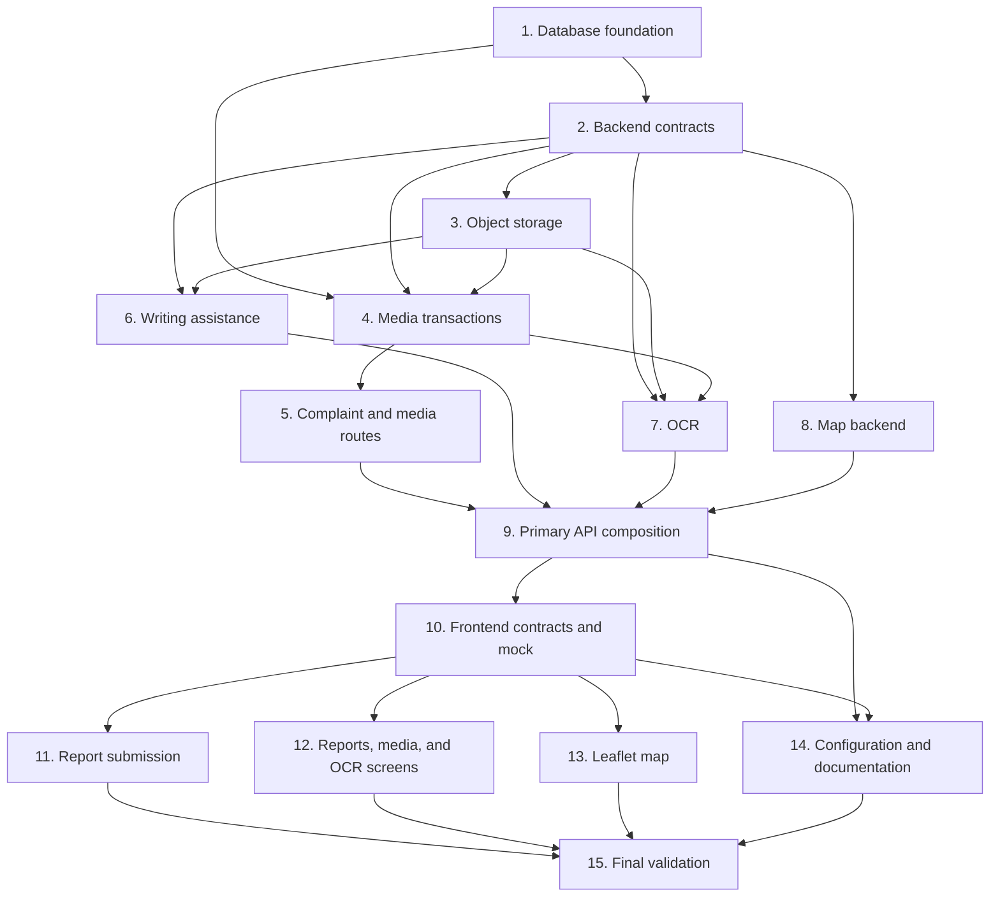

# Implementation Plan

## Overview

This plan implements the approved citizen complaint integrations in dependency order, from the additive database foundation through backend services and routes, primary API composition, frontend contracts and screens, documentation, and final validation. It preserves the unchanged behavior in `bugfix.md` and does not implement production code as part of planning.

> Scope note: Per user request, this plan does not create or modify test files. Implementation tasks must still run applicable existing checks and manually verify the reported workflows where automated coverage is absent.

## Tasks

- [ ] 1. Add the object-backed complaint media database foundation
  - [ ] 1.1 Create the ordered `20261114_create_object_backed_complaint_media.sql` migration in the accounts module
    - Create the metadata-only `complaint_media` table with complaint and uploader foreign keys, media type, private storage bucket and object key, verified file metadata, analysis fields, OCR text, timestamps, and the designed indexes.
    - Keep the migration additive and omit all binary image columns.
    - _Requirements: 2.2, 2.9, 3.7, 3.8_
  - [ ] 1.2 Add migration preflight handling for the incompatible legacy media table
    - Detect an existing `complaint_media.image_data` shape and fail with a clear migration message instead of treating it as migrated.
    - Do not export, drop, or destructively alter legacy media data in this change.
    - _Requirements: 2.2, 2.3, 3.12_

- [ ] 2. Add backend configuration, ORM, and API contracts
  - [ ] 2.1 Extend server settings for private Supabase media storage and Lumen services
    - Add the designed bucket, timeout, file-count, byte-size, pixel, signed-URL TTL, writing, and OCR settings.
    - Keep all secrets server-only, require HTTPS in production, and support `SUPABASE_SERVICE_KEY` only as the documented temporary alias.
    - Allow missing optional integration settings to fail only the requested capability.
    - _Requirements: 2.5, 2.8, 2.14, 3.10, 3.12_
  - [ ] 2.2 Add the metadata-only `ComplaintMedia` ORM model and relationships
    - Map the new table without introducing binary fields or changing existing complaint source-of-truth fields.
    - _Requirements: 2.2, 2.9, 3.7, 3.8_
  - [ ] 2.3 Add strict Pydantic schemas for media, composite submission, writing suggestions, OCR results, and map markers
    - Use allowlisted response fields, snake_case JSON, bounded text inputs, typed statuses and media types, and review-required indicators.
    - Return application media URLs rather than storage credentials, raw object-store responses, or persistent public URLs.
    - _Requirements: 2.1, 2.6, 2.9, 2.10, 2.12, 2.14, 3.6_
  - [ ] 2.4 Align citizen registration and complaint response schemas with the approved shared contract
    - Return `TokenResponse` from registration, support optional persisted `barangay`, and select staff complaint output only for official and administrator roles.
    - Keep citizen and anonymous complaint projections free of reporter details and staff-only fields.
    - _Requirements: 2.13, 3.5, 3.6, 3.12_

- [ ] 3. Implement private Supabase object storage
  - [ ] 3.1 Define injectable object-storage, writing-assistant, and OCR provider protocols and dependencies
    - Resolve configured adapters through FastAPI dependencies so routers and services do not import standalone application instances.
    - Reuse process-lifecycle HTTP clients rather than creating an unbounded client per request.
    - _Requirements: 2.13, 2.14, 3.10, 3.12_
  - [ ] 3.2 Implement the private Supabase bucket adapter
    - Support upload, download, bounded-retry delete, and short-lived signed URL creation with configured timeouts.
    - Translate provider failures into internal typed errors and exclude credentials, authorization headers, object bytes, and raw upstream bodies from logs and errors.
    - _Requirements: 2.2, 2.3, 2.8, 2.14, 3.12_
  - [ ] 3.3 Add server-mediated media content access behavior
    - Resolve a stored object key only after authorization and return either a short-lived redirect or safely streamed content using verified metadata and escaped disposition values.
    - _Requirements: 2.4, 2.14, 3.6, 3.8_
  - [ ] 3.4 Add the media reconciliation maintenance command
    - Find old objects under the controlled complaint prefix that have no matching metadata row and delete them with bounded retries and secret-safe operational logging.
    - _Requirements: 2.3, 2.14_

- [ ] 4. Implement validated media and transaction orchestration
  - [ ] 4.1 Add bounded image validation before any persistence
    - Reject empty, oversized, corrupt, unsupported, mislabeled, excessive-pixel, and decompression-bomb inputs.
    - Derive MIME type and extension from decoded JPEG, PNG, or WebP content, sanitize display filenames, and enforce the configured file-count limit.
    - _Requirements: 2.5, 2.14_
  - [ ] 4.2 Refactor complaint creation into a transaction-aware primitive
    - Preserve existing validation, duplicate locking, reference generation, audit behavior, and the commit behavior of the no-photo JSON path.
    - Allow composite creation to flush a complaint ID without a nested commit.
    - _Requirements: 2.1, 2.3, 3.1, 3.2, 3.3, 3.7_
  - [ ] 4.3 Implement all-or-nothing complaint creation with initial media
    - Validate every complaint field and file before writes, insert the complaint and media metadata in one MySQL transaction, and upload server-generated opaque object keys to the private bucket.
    - Return success only after the complaint, audit entry, and every media row commit.
    - _Requirements: 2.1, 2.2, 2.5, 3.1, 3.2, 3.3, 3.7_
  - [ ] 4.4 Compensate composite failures without reporting partial success
    - Roll back database changes, delete objects uploaded by the failed request where safe, record unresolved private objects for reconciliation, and return a retryable non-secret error.
    - _Requirements: 2.3, 2.14_
  - [ ] 4.5 Implement owner- and role-aware media operations
    - Permit citizens to add only initial media to their own complaint and staff to add progress or other media within their existing scope.
    - Authorize listing, content, and OCR before any private-object or external-service access.
    - _Requirements: 2.4, 2.9, 2.14, 3.8_

- [ ] 5. Expose complaint and media routes through the accounts module
  - [ ] 5.1 Add `POST /complaints/with-media`
    - Parse the complaint JSON part and repeated image parts, require at least one file, invoke composite orchestration, and return the complaint with saved non-secret media metadata.
    - _Requirements: 2.1, 2.3, 2.5, 2.13_
  - [ ] 5.2 Add complaint media upload, list, and content routes
    - Add `POST /complaints/{complaint_id}/media`, `GET /complaints/{complaint_id}/media`, and `GET /media/{media_id}/content` with active-user, ownership, role, media-type, and safe error enforcement.
    - _Requirements: 2.2, 2.4, 2.13, 2.14, 3.8_
  - [ ] 5.3 Permit only owner-scoped citizen complaint collection access
    - Allow citizens to call `GET /complaints?mine=true`, force the current user ID in the query, reject attempts to remove or substitute the owner scope, and leave staff filtering behavior unchanged.
    - _Requirements: 2.13, 3.5, 3.6, 3.7_
  - [ ] 5.4 Preserve existing complaint, duplicate, support, status, and audit behavior
    - Keep the manual JSON creation route and existing duplicate preview, support proximity, repeat-support, allowed status transition, staff filter, and audit paths intact while adopting role-aware response selection.
    - _Requirements: 3.1, 3.2, 3.3, 3.4, 3.5, 3.6, 3.7_

- [ ] 6. Implement normalized Lumen writing assistance
  - [ ] 6.1 Implement the server-side complaint writing adapter
    - Send only citizen-entered notes plus the constrained factual-writing instruction to the configured Lumen chat instance.
    - Normalize explicitly supported response shapes to one bounded, non-empty suggestion and reject unusable output without exposing sessions, histories, model metadata, raw bodies, or credentials.
    - _Requirements: 2.6, 2.8, 2.14, 3.9_
  - [ ] 6.2 Add `POST /assistant/complaint-draft`
    - Authenticate an active citizen before the Lumen call, validate notes, return `suggestion` with `review_required=true`, and map unavailable, timeout, rejection, and malformed responses to safe capability-specific errors.
    - Do not expose standalone diagnostic instance routes.
    - _Requirements: 2.6, 2.7, 2.8, 2.13, 2.14, 3.9, 3.10_

- [ ] 7. Implement object-backed Lumen OCR
  - [ ] 7.1 Implement the OCR adapter and normalization
    - Send only the authorized image bytes, verified MIME type, and sanitized filename with configured secure endpoint and timeout.
    - Normalize supported text responses and reject empty or unusable results without logging image bytes, OCR text, secrets, or raw upstream bodies.
    - _Requirements: 2.9, 2.10, 2.14_
  - [ ] 7.2 Add `POST /media/{media_id}/ocr`
    - Authorize owner or staff before downloading the private object or calling Lumen, save normalized text only to the associated media row, and return it with `review_required=true`.
    - Never write another image binary or change the complaint description.
    - _Requirements: 2.9, 2.10, 2.13, 2.14, 3.7, 3.8_

- [ ] 8. Implement the citizen-safe map backend
  - [ ] 8.1 Add validated map filter and pagination handling
    - Support repeated category and status filters, all-or-none ordered geographic bounds, default active statuses, and bounded page sizes.
    - Reject malformed coordinates, unknown or inactive categories, and unsupported statuses rather than ignoring them.
    - _Requirements: 2.11, 2.12_
  - [ ] 8.2 Implement the read-only map projection service
    - Return each matching complaint once using saved complaint coordinates and only the approved marker fields.
    - Exclude reporter/contact data, creator IDs, descriptions, private notes, media details, OCR text, authentication data, and secrets without mutating complaint, support, or media records.
    - _Requirements: 2.11, 2.12, 3.6, 3.7, 3.11_
  - [ ] 8.3 Add authenticated `GET /map/complaints`
    - Expose the validated, paginated marker projection to active users and return explicit safe errors for invalid input or unavailable dependencies.
    - _Requirements: 2.11, 2.12, 2.13, 2.14_

- [ ] 9. Connect all backend capabilities to the primary FastAPI application
  - [ ] 9.1 Aggregate auth, category, complaint, user, log, media, assistant, and map routers in `accounts_complaints`
    - Include each router once and avoid importing engines, settings, JWT helpers, or app objects from standalone services.
    - _Requirements: 2.13, 2.14, 3.5_
  - [ ] 9.2 Mount the aggregate router and shared HTTP-client lifespan in `lumen/apps/api/app/main.py`
    - Keep `/health`, expose the designed unprefixed backend routes behind the Next.js `/api` rewrite, and avoid contacting optional services during health checks.
    - _Requirements: 2.13, 2.14, 3.10_
  - [ ] 9.3 Make the local accounts module an explicit API runtime dependency
    - Update API packaging or installation configuration without runtime `sys.path` mutation.
    - _Requirements: 2.13, 3.12_
  - [ ] 9.4 Add capability-specific rate limiting and secret-safe error mapping
    - Apply separate upload, writing, and OCR limits while preserving existing complaint, duplicate, and support limits.
    - Trust forwarded client addresses only through configured proxy handling and return the designed safe status classes.
    - _Requirements: 2.8, 2.14, 3.3, 3.4_

- [ ] 10. Extend the frontend API, types, queries, and mock implementation
  - [ ] 10.1 Add strict TypeScript contracts for composite submissions, media, OCR, writing suggestions, and map markers
    - Align `MediaType` to `initial | progress | other`, preserve snake_case fields, and remove stale citizen/media assumptions.
    - _Requirements: 2.1, 2.6, 2.9, 2.10, 2.12, 2.13_
  - [ ] 10.2 Extend `PKonekApi` and the HTTP implementation
    - Add create-with-media, mine-list, media list/upload/content, OCR, draft suggestion, and map methods using the existing `/api` Axios client.
    - Let the browser set multipart boundaries and retain existing token attachment, normalized errors, and authenticated `401` handling.
    - _Requirements: 2.1, 2.4, 2.6, 2.8, 2.9, 2.11, 2.13, 2.14_
  - [ ] 10.3 Add stable query keys, hooks, mutations, and invalidation
    - Cover owned complaints, complaint details, media, assistant actions, OCR, map filters, and post-success invalidation of affected list, detail, media, and map data.
    - _Requirements: 2.1, 2.7, 2.10, 2.11, 2.13, 3.7, 3.11_
  - [ ] 10.4 Extend mock persistence and seed state for media and new contracts
    - Version or safely reset persisted mock state when introducing media collections.
    - Keep existing demo accounts and mock-mode selection working.
    - _Requirements: 2.13, 3.1, 3.12_
  - [ ] 10.5 Implement contract-compatible mock complaint, media, writing, OCR, and map methods
    - Validate all composite files before mock mutation, enforce ownership and media types, keep writing/OCR review-only, and mirror map filtering, pagination, privacy, and error behavior.
    - _Requirements: 2.1, 2.4, 2.5, 2.6, 2.7, 2.9, 2.10, 2.11, 2.12, 2.13, 3.6, 3.9, 3.11_

- [ ] 11. Build the citizen report submission experience
  - [ ] 11.1 Implement `CitizenReportForm` with manual complaint and location fields
    - Keep category, title, notes, authoritative description, address/barangay, and required map pin in explicit local state.
    - Preserve current server validation and manual submission when no photo or Lumen feature is used.
    - _Requirements: 3.1, 3.2, 3.7, 3.10_
  - [ ] 11.2 Add photo selection, preview, removal, and composite submission
    - Mirror file limits for usability, revoke object preview URLs, prevent duplicate submits, display upload progress, and show retryable failures without claiming unsaved files succeeded.
    - _Requirements: 2.1, 2.3, 2.5_
  - [ ] 11.3 Add duplicate preview and support handoff
    - Show safe duplicate candidate details on preview or `409` and preserve the existing explicit support action rather than bypassing the server decision.
    - _Requirements: 3.3, 3.4, 3.7_
  - [ ] 11.4 Add a separate writing-assistance review panel
    - Keep raw notes and the returned suggestion separate, provide use, copy, edit, and dismiss actions, and copy a suggestion into the authoritative description only after explicit citizen action.
    - Preserve notes and manual submission after assistance errors.
    - _Requirements: 2.6, 2.7, 2.8, 3.9, 3.10_
  - [ ] 11.5 Replace the canonical `/app/report` placeholder
    - Render the completed report feature under the existing protected citizen layout and route to the saved complaint or confirmation state after success.
    - _Requirements: 2.1, 2.7, 2.13, 3.1_

- [ ] 12. Build citizen report list, detail, media, and OCR screens
  - [ ] 12.1 Implement the authenticated citizen-owned report list
    - Load only `mine=true` data, show safe complaint fields and current status, and link each item to its detail route.
    - _Requirements: 2.13, 3.6, 3.7_
  - [ ] 12.2 Add the citizen complaint detail route and component
    - Render the saved complaint as the source of truth, show only owner-authorized media, and retain explicit support behavior where eligible.
    - _Requirements: 2.4, 3.3, 3.4, 3.6, 3.7_
  - [ ] 12.3 Implement media display, owner upload, and OCR controls
    - Use mediated content URLs, display verified metadata, and expose progress/error states for permitted media operations.
    - Show extracted OCR text separately with copy, use, edit, and ignore actions; never auto-overwrite or auto-submit the complaint.
    - _Requirements: 2.4, 2.9, 2.10, 2.14, 3.8_
  - [ ] 12.4 Replace the canonical `/app/reports` placeholder and add `/app/reports/[id]`
    - Connect dashboard and future marker navigation to the owned list and detail components under the protected layout.
    - _Requirements: 2.10, 2.13, 3.6_

- [ ] 13. Build the Leaflet community issues map
  - [ ] 13.1 Implement client-side map data and filter orchestration
    - Load active categories and every marker page for the current category, status, and bounds filters.
    - Debounce viewport changes, supersede stale requests, and expose loading, empty, partial, authentication, validation, and dependency-error states.
    - _Requirements: 2.11, 2.12, 2.13_
  - [ ] 13.2 Implement the no-SSR Leaflet marker renderer
    - Load Leaflet client-side with the established CSS/asset strategy and render exactly one marker per returned complaint.
    - Restrict popups to safe marker fields and link them to `/app/reports/{id}`.
    - _Requirements: 2.11, 2.12, 3.6, 3.7_
  - [ ] 13.3 Replace the canonical `/app/map` placeholder
    - Render the completed community map under the protected citizen layout and remove placeholder success notifications.
    - Keep map interactions read-only; support remains an explicit complaint-detail action.
    - _Requirements: 2.11, 2.13, 3.4, 3.11_

- [ ] 14. Unify configuration and retire disconnected production paths
  - [ ] 14.1 Reduce Next.js production proxying to one `/api` rewrite
    - Remove `MEDIA_PROXY_TARGET` and the separate media client after all frontend callers use the shared API client.
    - _Requirements: 2.13, 2.14, 3.12_
  - [ ] 14.2 Update server and web environment examples
    - Document placeholders for the private Supabase bucket, media limits, Lumen endpoints and timeouts, `API_PROXY_TARGET`, and mock mode without adding browser-visible secrets or external service credentials.
    - _Requirements: 2.14, 3.12_
  - [ ] 14.3 Update accounts-module and standalone-service documentation
    - Document migration order, private-bucket prerequisites, primary API mounting, the unified run path, and the operational reconciliation command.
    - Mark media, chatbot, and map standalone launch paths and the legacy binary schema as superseded without deleting data or production files.
    - _Requirements: 2.2, 2.3, 2.13, 2.14, 3.8, 3.12_

- [ ] 15. Validate the integrated fix and preserved behavior
  - [ ] 15.1 Validate migration and backend route composition
    - Apply the baseline and ordered migrations to a disposable database, inspect the media table for required keys/indexes and absence of binary columns, and confirm the primary app exposes auth, complaint, media, assistant, OCR, and map routes.
    - _Requirements: 2.1, 2.2, 2.9, 2.11, 2.13_
  - [ ] 15.2 Run existing backend checks and manually verify integration failure boundaries
    - Run the repository's existing backend test and static-check commands without creating new test files.
    - Verify invalid media causes no writes, authorization precedes storage/Lumen access, composite failures report no partial success, and optional integration failures leave manual complaint submission available.
    - _Requirements: 2.3, 2.4, 2.5, 2.8, 2.14, 3.1, 3.10_
  - [ ] 15.3 Run existing frontend test, lint, and production build commands
    - Verify real and mock mode compile against the same contracts and manually exercise report, owned list/detail, media/OCR review, writing review, and map filtering flows.
    - _Requirements: 2.1, 2.6, 2.7, 2.10, 2.11, 2.12, 2.13, 3.9, 3.11_
  - [ ] 15.4 Perform privacy, secret, and regression checks
    - Scan API responses, captured logs, source, and generated client bundles for configured secret sentinels and unintended `NEXT_PUBLIC_*` integration values.
    - Confirm complaint validation, duplicates, support, staff filters/status/audit, reporter privacy, opt-in Lumen behavior, and map non-mutation remain unchanged.
    - _Requirements: 2.14, 3.2, 3.3, 3.4, 3.5, 3.6, 3.7, 3.8, 3.9, 3.10, 3.11, 3.12_

## Task Dependency Graph

```json
{
  "waves": [
    { "wave": 1, "tasks": ["1"] },
    { "wave": 2, "tasks": ["2"] },
    { "wave": 3, "tasks": ["3", "8"] },
    { "wave": 4, "tasks": ["4", "6"] },
    { "wave": 5, "tasks": ["5", "7"] },
    { "wave": 6, "tasks": ["9"] },
    { "wave": 7, "tasks": ["10"] },
    { "wave": 8, "tasks": ["11", "12", "13", "14"] },
    { "wave": 9, "tasks": ["15"] }
  ]
}
```



## Notes

- Requirement references point to the expected and unchanged behavior clauses in `bugfix.md`.
- Parent tasks group related work; numbered subtasks are the atomic implementation units.
- Tasks 6 and 8 can proceed in parallel after task 2; task 7 additionally depends on the storage and media foundations.
- Tasks 11, 12, and 13 can proceed in parallel after the shared frontend contract and mock work in task 10.
- Do not create or modify test files. Use existing checks plus focused manual verification in task 15.
- Do not perform destructive legacy-media migration, bucket deletion, or schema rollback as part of this plan.